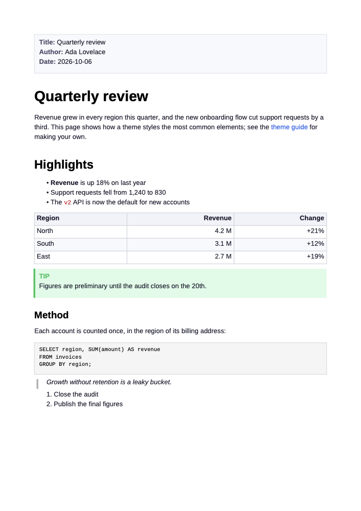
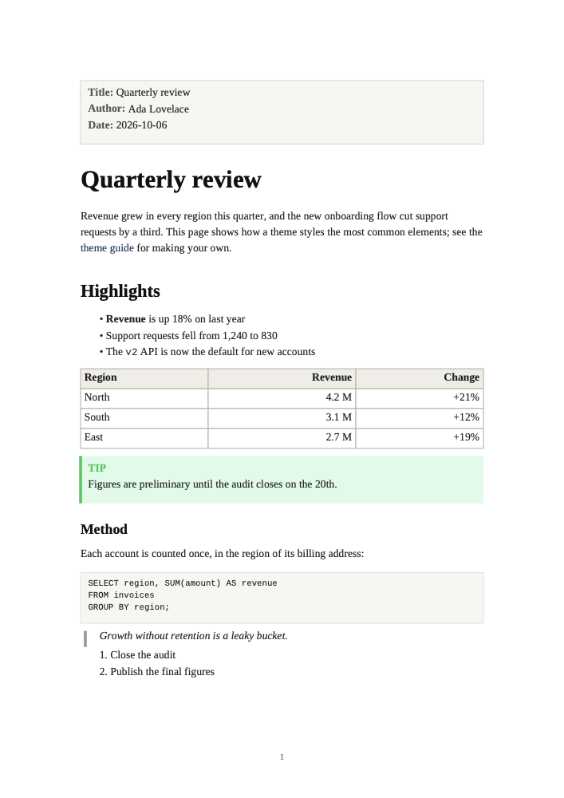
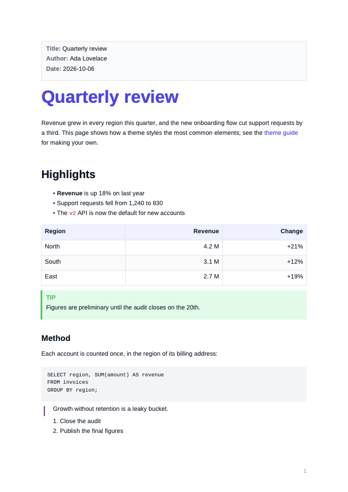
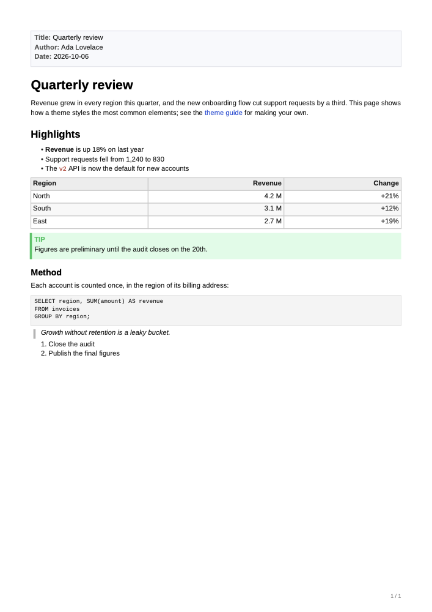
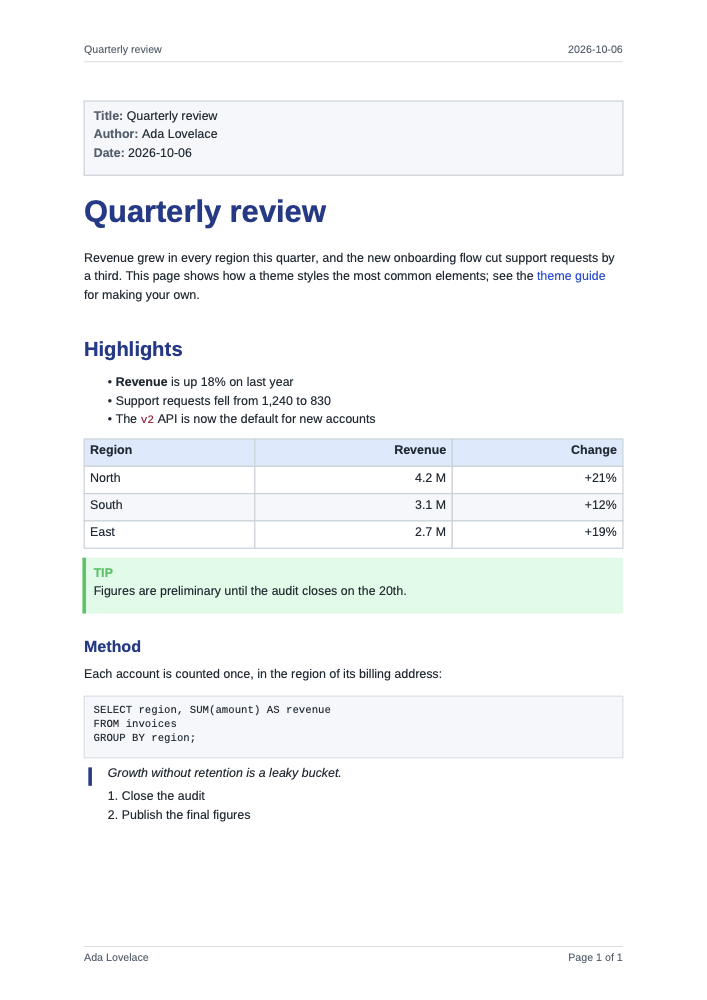

# Themes

A theme decides how a converted document looks: the paper and its margins,
the fonts, the sizes and spacing of every element, the colors, and whether
pages carry a header and a footer. The same theme styles both PDF and DOCX.

- [Built-in themes](#built-in-themes)
- [Using a theme](#using-a-theme)
- [Your first theme](#your-first-theme)
- [How a theme file works](#how-a-theme-file-works)
- [Fonts](#fonts)
- [Headers and footers](#headers-and-footers)
- [Cover page](#cover-page)
- [Settings reference](#settings-reference)
- [When something goes wrong](#when-something-goes-wrong)

## Built-in themes

Five themes come with markout. Each picture is the first page of
[`themes/sample.md`](themes/sample.md) as PDF.

| | |
| --- | --- |
| **default**: the standard markout look | **classic**: serif type, wide margins, restrained color |
|  |  |
| **modern**: sans-serif and airy, one vivid accent | **compact**: small type, narrow margins, fewer pages |
|  |  |
| **report**: title and date in the header, page numbers in the footer | |
|  | |

The default theme is the one markout has always used. For historical reasons
its PDF and DOCX forms differ a little: PDF is sans-serif with 20 mm margins,
DOCX uses Georgia with 25 mm margins and larger headings. The other four use
the same values in both formats.

## Using a theme

**In the TUI**, press `F2` for the settings, `Tab` to switch to the **Theme**
tab, choose one and press `Enter`. The choice is saved and shown in the
Convert box.

**On the command line**, name a theme or a theme file:

```sh
markout --theme report input.md output.pdf
markout --theme ./mytheme.toml input.md output.docx
markout --list-themes
```

Without `--theme`, a conversion uses the theme saved in the TUI.

## Your first theme

**1. Start from a complete example.** `--export-theme` prints a theme as a
file with every setting written out and commented:

```sh
markout --export-theme > mytheme.toml           # the default theme
markout --export-theme report > mytheme.toml    # or start from another
```

**2. Delete what you do not want to change.** A theme only needs to list what
differs from the theme it extends. This is a complete theme:

```toml
description = "House style"
extends = "default"

[fonts]
body = "serif"

[heading]
color = "#7A1E1E"

[link]
color = "#7A1E1E"
```

**3. Try it** on the showcase document, which contains every element with a
note on what it should look like:

```sh
markout --theme mytheme.toml fixtures/showcase.md showcase.pdf
markout --theme mytheme.toml fixtures/showcase.md showcase.docx
```

Edit the file and convert again until it looks right. In the TUI, a theme is
read afresh for every conversion, so there is no need to restart.

**4. Install it** so it can be chosen by name. `--list-themes` ends with the
location of your themes directory; put the file there:

```sh
markout --list-themes
# ...
# Your own themes go in /home/you/.config/markout/themes
```

A file `house.toml` in that directory is the theme `house`: it appears on the
Theme tab and works with `--theme house`.

## How a theme file works

A theme file is [TOML](https://toml.io): `[section]` headers followed by
`key = value` lines.

**`extends`** names the theme to build on: a built-in theme, one in your
themes directory, or a file path relative to the theme file. Without it a
theme extends `default`. Whatever a theme does not set comes from the theme it
extends.

```toml
extends = "report"
```

**`description`** is the line shown next to the theme in lists. It is text in
quotes.

**Lengths** are numbers of points (1/72 inch), or text with a unit:

```toml
[page]
margin-top = 72          # 72 points
margin-left = "25mm"     # also: "2.5cm", "1in", "12pt"
```

A length is a finite number: `nan` and `inf` are refused. A page side is
between 72 and 14400 points, a margin is not negative and less than half the
page, and a space, padding or indent is between 0 and 400 points. A font size
is between 1 and 400.

**Colors** are `"#RRGGBB"` in quotes.

**Both formats, or one.** Settings at the top level apply to PDF and DOCX
alike. To set something for one format only, put the same section under
`[pdf]` or `[docx]`:

```toml
[text]
size = 11            # both formats

[docx.text]
size = 10.5          # DOCX only

[pdf.page]
margin = "20mm"      # PDF only
```

If you extend `default` and notice a difference between the two formats that
you did not ask for, it is one the default theme has; set that value at the
top level to make both agree.

## Fonts

Three font families are built into markout and work everywhere:

| Name | PDF | DOCX names it |
| --- | --- | --- |
| `sans` | Liberation Sans | Arial |
| `serif` | Liberation Serif | Times New Roman |
| `mono` | Liberation Mono | Courier New |

```toml
[fonts]
body    = "serif"
heading = "sans"
code    = "mono"
```

**A font of your own** is a family defined from `.ttf` files under
`[fonts.family.NAME]`, then used by that name:

```toml
[fonts]
heading = "brand"

[fonts.family.brand]
regular     = "fonts/Brand-Regular.ttf"   # relative to the theme file
bold        = "fonts/Brand-Bold.ttf"
italic      = "fonts/Brand-Italic.ttf"
bold-italic = "fonts/Brand-BoldItalic.ttf"
name        = "Brand Sans"                # what the font is called, for DOCX
```

Only `regular` is required; a style that is missing falls back to the nearest
one the family has.

The two formats treat fonts differently:

- **PDF embeds** the font, so the document looks the same for everyone.
- **DOCX only names** the font. Whoever opens the document needs it installed,
  or their word processor substitutes another. To use a font name in DOCX
  without a font file, set it for DOCX alone:

  ```toml
  [docx.fonts]
  body = "Georgia"
  ```

The built-in monospace font has no bold or italic of its own, so code is
always regular weight in PDF.

## Headers and footers

`[header]` and `[footer]` put a line of text in the top and bottom margin of
every page. Each has three positions:

```toml
[header]
left  = "{title}"
right = "{date}"
rule  = true              # a line under the header

[footer]
left   = "{author}"
center = "Page {page} of {pages}"
rule   = true             # a line above the footer
```

The text may contain:

| Placeholder | Becomes |
| --- | --- |
| `{title}` | the title from the document's front matter, or its first top-level heading |
| `{author}` | the author from the front matter |
| `{date}` | the date from the front matter |
| `{version}` | the version from the front matter, as the control block shows it (`1.0`) |
| `{classification}` | the classification from the front matter |
| `{page}` | the page number |
| `{pages}` | the number of pages |

A placeholder with nothing to show leaves nothing behind. With all three
positions empty there is no header or footer, which is how the default theme
has it.

The text sits in the middle of its margin, so the margin has to be large
enough for it; markout says so if it is not.

## Cover page

A document with front matter can start with a cover page: the title in large
type, the subtitle under it, and under them the control block with the rest of
the front matter. The text starts on the next page.

```markdown
---
title: Mentési eljárásrend
subtitle: Informatikai üzemeltetés
version: 1.2
classification: Belső
cover: true
---
```

The `cover` key of the front matter asks for it (`true`) or refuses it
(`false`). Without the key the theme decides: with `enabled = true` every
document that has front matter gets a cover page.

```toml
[cover]
enabled = true
```

`cover: false` turns the cover off for one document of a theme that gives
them all one. `true`, `false`, `yes` and `no` count, in any case; anything
else is ignored, and markout says so. A document without front matter has no
cover page.

The title is the `title` of the front matter, or the first top-level heading
if there is none. `subtitle` is the key with that name; on a page without a
cover it is an ordinary row of the control block. The cover page counts as
page 1 in `{page}` and `{pages}`, but carries no header or footer. The `cover`
key is never shown as a row of the control block.

## Classification and watermark

The front matter can classify a document and mark it. Both appear on every
page, the cover page included.

```markdown
---
title: Mentési eljárásrend
classification: Belső használatra
watermark: TERVEZET
---
```

### The classification band

`classification` puts a band across the top of every page, over the full width
of the paper, with the classification centered in it in bold type. It is also
a row of the control block. The band shows the classification as the document
writes it (`Belső használatra`, not a word of the theme's), and the theme
decides the colors by the **level** the classification belongs to.

A theme knows four levels, which every theme inherits:

| Level | Names it is recognized by | Band |
| --- | --- | --- |
| `public` | `public`, `nyilvános` | white on green |
| `internal` | `internal`, `belső`, `belső használatra` | white on blue |
| `confidential` | `confidential`, `bizalmas` | white on amber |
| `secret` | `secret`, `titkos`, `szigorúan titkos` | white on red |

A classification is matched with the names whatever its case and the spaces
in it: `BELSŐ  használatra` is `internal`. One that no level knows
(`Top secret`) gets the **neutral colors**, white on gray unless the theme says
otherwise, and markout warns, naming the levels the theme has.

A theme file adds names to a level, changes the colors of a level, or adds a
level of its own, as `[classification.NAME]` with any name for NAME:

```toml
[classification.confidential]
names = ["restricted"]            # added to the names it has
background = "#8A4B08"

[classification.sensitive]        # a new level
names = ["Sensitive", "Érzékeny"]
color = "#000000"
background = "#FFD54F"
```

The names of a level are added to those it already has, so a theme cannot
take one away; a name belongs to one level only. A new level has the neutral
colors until it sets its own.

`band = false` turns the band off for every document of a theme:

```toml
[classification]
band = false
```

The band sits in the top margin, so `height` (default 16 points) has to stay
well under `page.margin-top`, or the page's text starts under the band. A
header does not collide with it: where the margin is too small to hold both in
their usual places, the header moves into the room under the band.

### The watermark

`watermark` draws its text in light gray, large, running from the bottom left
to the top right of every page. Without the key there is no watermark. The text
is drawn at `size` (default 96 points), or smaller if it would not fit across
the page. It is drawn first, under the page's text and under whatever has a
background of its own (a table cell, a code block, a callout), which hide it
where they are. Only text counts: `watermark: 2026` or a list is ignored, and
markout says so. The `watermark` key is never shown as a row of the control
block.

```toml
[watermark]
color = "#E6E6E6"
size  = 96
```

### In DOCX

The band and the watermark are shapes in the header of the document, anchored
to the page as Word anchors such things: the band is a text box across the top
edge, and the watermark is Word's own text watermark (the one under Design >
Watermark), set in the body font and rotated up to the right. Both lie behind
the text, and neither moves the header text or the margins. A theme without a
header still gets a header part to hold them. With a cover page the cover has
the band and the watermark too, though no header or footer text. A header text
that reaches into the band stays where it is, so keep `height` under the
header margin.

The watermark is sized from the widths of the built-in sans font, so a theme
with a wider body font shows the same text stretched to the same width.

## Settings reference

Every section and setting, with what it controls. Run
`markout --export-theme` for the same list with the default values.

### `[page]`

| Setting | Meaning |
| --- | --- |
| `size` | Paper size by name: `A3`, `A4`, `A5`, `Letter`, `Legal`, `Tabloid` |
| `orientation` | `portrait` or `landscape` |
| `width`, `height` | Paper dimensions, for a size that has no name |
| `margin` | All four margins at once |
| `margin-top`, `margin-right`, `margin-bottom`, `margin-left` | One margin; overrides `margin` |

### `[fonts]`

| Setting | Meaning |
| --- | --- |
| `body` | Font of ordinary text |
| `heading` | Font of headings |
| `code` | Font of inline code and code blocks |

See [Fonts](#fonts) for `[fonts.family.NAME]`.

### `[text]`

| Setting | Meaning |
| --- | --- |
| `size` | Size of body text |
| `line-height` | Distance from one line to the next |
| `paragraph-spacing` | Space after a paragraph |
| `align` | `"left"` (the default), or `"justify"` for text flush on both sides; see below |
| `hyphenate` | `"auto"` (the default), `"always"` or `"never"`; see below |
| `color` | Color of body text, lists, quotes and tables |
| `muted` | Captions and labels |
| `faint` | Struck-through text |

With `align = "justify"` paragraphs, list items, quotes and callouts are set
flush on both sides; the last line of each stays as it is. Headings, table
cells, captions and code stay flush left: in a narrow column the words of a
justified line end up far apart.

In PDF a line whose word spaces would have to grow to more than three times
their width is left ragged. That happens where a long word did not fit at
the end of the line before, most often in a narrow list item.

`hyphenate` says whether a word that does not fit at the end of a line is
broken there:

| Value | Words are broken in |
| --- | --- |
| `"auto"` | justified text, so nowhere unless `align` is `"justify"` |
| `"always"` | paragraphs, list items, quotes and callouts however they are aligned, and table cells, definitions and footnotes too |
| `"never"` | nothing |

Headings, captions and code are never hyphenated. Neither are words of fewer
than five letters or with a digit in them, and no more than three lines in a
row end in a hyphen.

Words are hyphenated by the rules of the [language of the
document](../README.md#language). In PDF markout does it, and has the rules
of Hungarian (`hu`), American English (`en-US`) and British English
(`en-GB`); for a document in another language, or one that names none, the
words stay whole and markout says so. In DOCX the word processor does it,
with the rules it has.

A justified theme that is hyphenated where it can be:

```toml
extends = "default"

[text]
align = "justify"
```

A soft hyphen in the Markdown (`&shy;`, as in `rendszer&shy;üzemeltetés`)
marks where a word may be broken. In PDF the word is then broken there and
nowhere else, in any text and in any language, unless `hyphenate` is
`"never"`.

### `[heading]` and `[heading.h1]` to `[heading.h6]`

A setting directly under `[heading]` applies to all six levels;
`[heading.h1]` … `[heading.h6]` set one level.

| Setting | Meaning |
| --- | --- |
| `size` | Font size |
| `line-height` | Height of a heading line |
| `space-before` | Space above the heading |
| `space-after` | Space below it |
| `color` | Color |

### `[link]`

| Setting | Meaning |
| --- | --- |
| `color` | Color of links and footnote numbers |

### `[code]`

| Setting | Meaning |
| --- | --- |
| `color` | Inline code |
| `block-size` | Font size in code blocks |
| `block-line-height` | Line height in code blocks |
| `padding` | Space inside the panel of a code block |
| `space-after` | Space below a code block |
| `block-color` | Text in code blocks |
| `background` | Panel background |
| `border` | Panel border |

### `[code.syntax]`

A code block that names its language (` ```go `, ` ```python `, ...) has
its code colored by what it means. Everything these settings do not name
(punctuation, variable names) keeps `block-color`, and so does all the code
of a block with no language or one markout does not know.

| Setting | Meaning |
| --- | --- |
| `highlight` | `false` leaves all code in `block-color` |
| `keyword` | Keywords, and tag names in markup |
| `string` | Text in quotes |
| `comment` | Comments |
| `number` | Numbers and other literal values |
| `function` | Function names, and attribute names in markup |
| `type` | Type names and built-in names |

The colors are for a light panel. A theme that makes `background` dark
should set them all:

```toml
[code]
background  = "#1E1E2E"
block-color = "#CDD6F4"

[code.syntax]
keyword  = "#CBA6F7"
string   = "#A6E3A1"
comment  = "#9399B2"
number   = "#FAB387"
function = "#89B4FA"
type     = "#F9E2AF"
```

### `[list]`

| Setting | Meaning |
| --- | --- |
| `indent` | Indentation per nesting level |
| `space-after` | Space below a list |

### `[table]`

| Setting | Meaning |
| --- | --- |
| `cell-padding` | Space inside each cell |
| `line-height` | Line height of cell text |
| `space-after` | Space below a table |
| `border` | Grid lines |
| `header-background` | Header row |
| `row-background` | Body rows |
| `stripe-background` | Every other body row; set it equal to `row-background` for no stripes |

### `[quote]`

| Setting | Meaning |
| --- | --- |
| `indent` | Indentation of the quoted text |
| `bar` | Color of the line on the left |
| `bar-width` | Its thickness |
| `italic` | `true` to set quotes in italics |
| `space-after` | Space after each quoted paragraph |

### `[rule]`

| Setting | Meaning |
| --- | --- |
| `width` | Thickness of a horizontal rule |
| `space` | Space above and below it |
| `color` | Its color; also used for header and footer rules |

### `[alert]` and `[alert.note]`, `[alert.tip]`, `[alert.important]`, `[alert.caution]`, `[alert.warning]`

Callouts such as `> [!NOTE]`. A callout without a title of its own is
titled by its kind, in the language of the document: `NOTE`, `TIP`,
`IMPORTANT`, `CAUTION` and `WARNING` in English, `MEGJEGYZÉS`, `TIPP`,
`FONTOS`, `VIGYÁZAT` and `FIGYELEM` in Hungarian. A title written by the
author (`> [!NOTE] My title`) is shown as written.

| Setting | Meaning |
| --- | --- |
| `padding` | Space inside the box (`[alert]`) |
| `bar-width` | Thickness of the bar on the left (`[alert]`) |
| `space-after` | Space below the box (`[alert]`) |
| `background` | Background of one kind of callout (`[alert.note]` etc.) |
| `border` | Its bar and title color (`[alert.note]` etc.) |
| `label` | The title of a callout of this kind that has none of its own, such as `label = "Megjegyzés"` (`[alert.note]` etc.). Empty: given in the language of the document |

### `[box]`

The panel showing the document's front matter.

| Setting | Meaning |
| --- | --- |
| `background` | Panel background |
| `border` | Panel border |

### `[diagram]`

The boxes of a flowchart, and the panel holding the source of a diagram
that is not drawn. The frames of a chart's subgraphs take the colors of
`[box]`, and its connecting lines the `muted` color of `[text]`.

| Setting | Meaning |
| --- | --- |
| `background` | Inside of a chart's boxes; panel background |
| `border` | Outline of a chart's boxes; panel border |
| `text` | Text in a chart; label and source text of the panel |

### `[footnote]`

| Setting | Meaning |
| --- | --- |
| `size` | Font size of footnotes |
| `line-height` | Their line height |
| `rule` | Color of the line above the footnote section |

### `[caption]`

| Setting | Meaning |
| --- | --- |
| `size` | Font size of the text under an image |

### `[colors]`

| Setting | Meaning |
| --- | --- |
| `math` | The source of a formula that could not be typeset. Typeset formulas have the color of the text around them |
| `highlight` | Background of `==marked==` text |
| `inserted` | Additions in inline diffs |
| `deleted` | Removals in inline diffs |

### `[header]` and `[footer]`

| Setting | Meaning |
| --- | --- |
| `left`, `center`, `right` | Text at each position; see [Headers and footers](#headers-and-footers) |
| `size` | Font size |
| `color` | Text color |
| `rule` | `true` for a line between it and the page's text |

### `[cover]`

The [cover page](#cover-page).

| Setting | Meaning |
| --- | --- |
| `enabled` | `true` gives every document with front matter a cover page; `cover: false` in the front matter of one takes it off. Default `false` |
| `title-size` | Font size of the title. Default 28 |
| `title-color` | Color of the title. Default: the color of first-level headings of the default theme |
| `subtitle-size` | Font size of the subtitle. Default 16 |
| `subtitle-color` | Color of the subtitle. Default: the `muted` color of `[text]` |
| `top` | How far below the top margin the title starts. Default 160 |

### `[classification]`

The [classification band](#the-classification-band) and the colors of a
classification that no level knows.

| Setting | Meaning |
| --- | --- |
| `band` | `false` draws no band, whatever the front matter says. Default `true` |
| `size` | Font size of the text in the band, which is bold. Default 8.5 |
| `height` | Height of the band, which sits in the top margin. Default 16 |
| `color` | Text color for a classification that no level knows. Default white |
| `background` | Band color for a classification that no level knows. Default gray |

### `[classification.NAME]`

A level of classification, one section for each, with any name for NAME. The
levels `public`, `internal`, `confidential` and `secret` exist in every theme.

| Setting | Meaning |
| --- | --- |
| `names` | A list of the words that mean this level, such as `["internal", "belső"]`. They are matched in any case, and are added to the names the level has |
| `color` | Text color of the band. A new level has the neutral `color` until it sets this |
| `background` | Background color of the band. A new level has the neutral `background` until it sets this |

### `[watermark]`

The [watermark](#the-watermark) text.

| Setting | Meaning |
| --- | --- |
| `color` | Color of the text. Default `#E6E6E6`, light enough for text over it to stay readable |
| `size` | Font size. Default 96; the text is drawn smaller if it would not fit across the page |

### `[control.labels]`

The labels of the document control block, the table the front matter is
shown in. An empty label is given in the language of the document, Hungarian
or English.

| Setting | Meaning |
| --- | --- |
| `title`, `version`, `status`, `author`, `owner`, `approved-by`, `date`, `review-date`, `classification` | The label of that field, such as `version = "Kiadás"` |

`[control]` holds nothing else yet.

### `[toc]`

The generated table of contents.

| Setting | Meaning |
| --- | --- |
| `title` | The title above the entries, such as `title = "Contents"`. Empty: given in the language of the document, `Table of Contents` in English and `Tartalomjegyzék` in Hungarian |

### PDF and DOCX

A theme applies to both formats, with two differences that come from what the
formats are:

- **PDF is drawn by markout**, so it comes out exactly as the theme says.
- **DOCX is laid out by the word processor** that opens it. markout writes
  the theme's fonts, sizes, colors, margins, line heights, spacing, indents
  and rules into the document, and Word or LibreOffice does the rest: where
  lines and pages break is their decision, and line heights are a minimum
  (taller content gets its room).

  The look of body text and of headings goes into the document's *Normal*
  and *Heading 1* to *Heading 6* styles, not onto each piece of text, so the
  document can be restyled in Word afterwards. List bullets and numbers are
  drawn by the word processor, a little further from the text than in PDF.

### What a theme does not control

- Bullets and numbering style.

## When something goes wrong

A theme that cannot be used is never replaced silently by the default: the
conversion stops and says what is wrong, naming the file and the setting.

```
theme mytheme.toml: text.sizee is not a setting; [text] has color, faint,
line-height, muted, paragraph-spacing, size
```

| Message | What to do |
| --- | --- |
| `… is not a setting; [x] has …` | A misspelled key. The message lists the valid ones. |
| `there is no section [x]` | A misspelled section name. |
| `… is not of the form #RRGGBB` | Write colors as `"#1A2B3C"`, in quotes. |
| `… is not a length` | Use a number of points, or a unit: `"25mm"`, `"1in"`. `nan` and `inf` are not lengths. |
| `… points; it must be between …` | A size or a space outside the limits named in the message. |
| `… is not a font PDF can use` | Use `sans`, `serif` or `mono`, define a family from `.ttf` files, or move a plain font name under `[docx.fonts]`. |
| `font file … cannot be read` | Paths are relative to the theme file. |
| `the margins leave no room for text` | The margins add up to more than the page. |
| `the top margin … is too small to hold a header` | Increase the margin the message names. |
| `there is no theme named …` | Check `--list-themes`; a theme file is named by its path, ending in `.toml`. |

In the TUI, a theme in your themes directory that has a problem is still
listed, with the problem as its description, so you can see why it cannot be
chosen.
